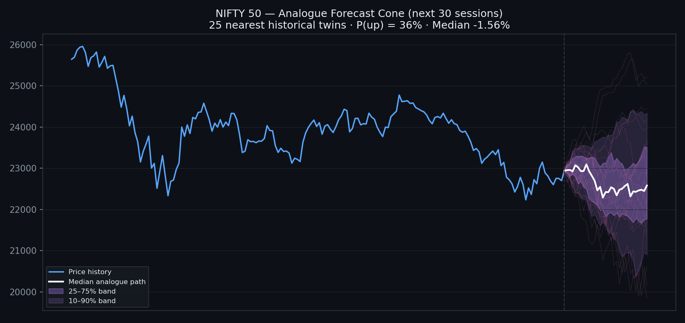

# Arthon — Multi-Agent Quantitative Stock Research

A modular, transparent **multi-agent system for quantitative stock research**
on Indian (NSE/BSE) and global equities. Specialist agents analyse a stock
from independent angles, state their evidence, openly disagree when the data
says so, and a decision agent combines them into a single, traceable rating.
Includes historical backtesting with transaction costs, benchmark
comparison, and out-of-sample evaluation of the forecasting method itself.

> **Educational research project — not financial advice.** Backtested
> performance is simulation, not live trading. Forecasts are simple
> statistical models and are wrong regularly; every report includes the
> forecast method's measured out-of-sample accuracy so you can judge for
> yourself.

Built by Ayush Shukla with eider (Muse). The *idea* of a multi-agent
research team was inspired by TradingAgents, Kronos and ai-hedge-fund from
the author's starred collection; all code in this repository is original.



*The pattern engine on NIFTY: a historical-analogue forecast cone — the range
of paths that similar past patterns actually took, not a single line of false
precision.*

## The team

| Agent | Job | Method |
|---|---|---|
| Analyst | Trend & momentum opinion | Price vs SMA 20/50/200, RSI, MACD, 3-month return |
| Fundamentals | Valuation context | Statement fields when a provider returns them (P/E, ROE, debt) + 52-week-range position; scores **neutral and says so** when statement data is unavailable — never invents financials |
| Forecast | 30-day outlook | Log-price trend regression (120 sessions) blended with 20-day momentum, with a volatility band; evaluated walk-forward in every report |
| Risk | Risk rating & sizing guide | Annualised volatility, max drawdown, historical VaR & CVaR (95%), beta & correlation vs benchmark, volatility-target position guide |
| Decision | Final rating | Weighted vote (0.40/0.30/0.10/0.20) → BUY, HOLD/WATCH or SELL/AVOID. If Analyst and Forecast strongly disagree, it shrinks the score and caps conviction instead of faking precision |

Plus a **Backtesting Engine** (trend rule vs buy-and-hold vs benchmark, asset-aware
transaction costs — STT/brokerage schedules differ per asset class and broker;
see `src/arthon/costs.py`),
cost per position change, Sharpe, Sortino, drawdown) and **watchlist mode**
(runs the whole pipeline per ticker and ranks by team score).

## Quick start

```bash
git clone https://github.com/Ayushshuklai/arthon.git
cd arthon
pip install .

arthon RELIANCE.NS              # NSE (INR)
arthon TCS.NS --years 5
arthon AAPL                     # US tickers work too
arthon --watchlist RELIANCE.NS,TCS.NS,MRF.NS,MAZDOCK.NS
```

No API key is needed. Data comes from Yahoo Finance's public chart API
(end-of-day; **not real-time, no exchange connectivity**). Downloads are
cached locally in `data/cache/` (git-ignored — see Data & licensing).
Reports are written to `reports/` as Markdown.

## Sample findings (data to 29 Oct 2026)

| Ticker | Rating | Honest highlight |
|---|---|---|
| RELIANCE.NS | HOLD/WATCH | Trend rule beat buy-and-hold while halving drawdown in v1 tests |
| MAZDOCK.NS | SELL/AVOID | Forecast method's direction accuracy on this stock: 40% — the report shows it |
| AAPL | HOLD/WATCH | Team score +0.28, just under the BUY threshold |

Full reasoning, evidence and caveats: [`reports/`](reports/)

## Methodology in one paragraph

Agents score in [-1, +1] from stated formulas (see `docs/ARCHITECTURE.md`).
Backtest signals are computed at the close and executed the next day —
no look-ahead — with costs charged on every position change. The forecast
method is re-evaluated walk-forward at five historical origins for every
report (mean absolute error and direction accuracy). Single-ticker
backtests are survivorship-conditional and are labelled as such.

## Data & licensing

Yahoo Finance data is fetched for local use under Yahoo's terms; the raw
downloaded price history is **not redistributed in this repository**
because public accessibility is not a redistribution licence. Details,
coverage and known gaps (including why statement fundamentals are often
unavailable): [`docs/DATA_SOURCES.md`](docs/DATA_SOURCES.md).

## Tests

```bash
python -m unittest discover -s tests -v   # 16 tests, synthetic data, no network
```

CI runs the same suite on every push (`.github/workflows/tests.yml`).

## Layout

```
src/arthon/  data.py indicators.py agents.py evaluation.py
                     backtest.py costs.py pattern_ai.py strategies.py
                     report.py cli.py
docs/                ARCHITECTURE.md, DATA_SOURCES.md, images/
reports/             13 reviewed sample reports + strategy backtest outputs
tests/               unit tests for critical calculations
tradingview/         arthon.pine — Pine Script twin of the EMA agents
```

## Roadmap

Kronos behind the forecast interface, a licensed fundamentals provider,
a news/sentiment agent, and an LLM debate layer: [`ROADMAP.md`](ROADMAP.md)

## Licence

MIT — see [`LICENSE`](LICENSE). Read it, learn from it, build on it.
