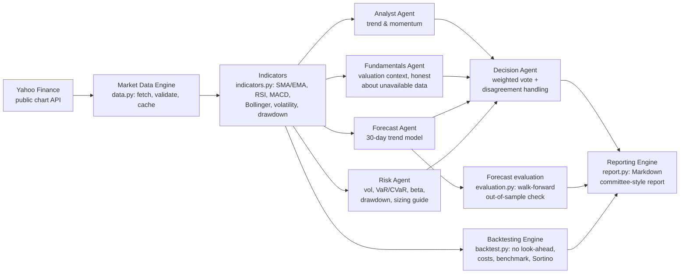

# Architecture

## Design rules
1. **Structured opinions.** Every agent returns an `Opinion` (score in
   [-1, +1], headline, evidence strings, metrics dict). The report renders
   evidence verbatim — claims in the output are traceable to the agent and
   the formula that produced them.
2. **No blind acceptance.** The Decision Agent checks the Analyst–Forecast
   spread; above 1.0 it shrinks the combined score by 25%, caps conviction,
   and records the disagreement in the report.
3. **Honest degradation.** Missing data (e.g. statement fundamentals)
   produces a neutral score plus an explicit note — never an estimate
   dressed up as data.
4. **No look-ahead.** Backtest signals are computed at the close and
   executed the next day; forecast evaluation is walk-forward.
5. **Costs are explicit and asset-aware.** Each asset class carries its own
   buy/sell bps profile (STT, brokerage, exchange charges; `costs.py`), a
   documented assumption — see `backtest.py`.

## Portfolio analytics
`cli.py --watchlist A,B,C` runs the full pipeline per ticker and ranks by
team score, writing one report per ticker. (Position-level portfolio
optimisation is intentionally not claimed; it is a roadmap item.)
